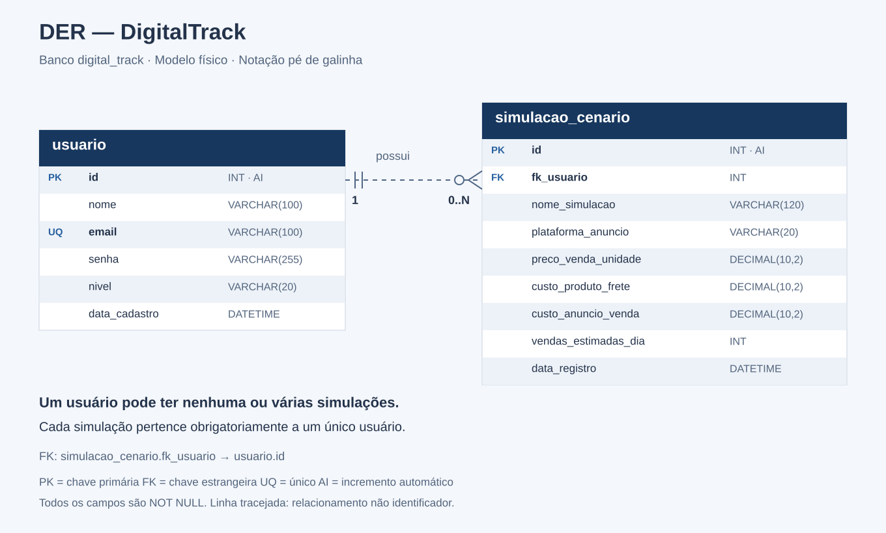

# DER — DigitalTrack

## Relacionamento

**usuario (1) → simulacao_cenario (0..N)**

Um usuário pode existir sem simulações ou cadastrar várias. Cada simulação pertence obrigatoriamente a um único usuário, identificado por `fk_usuario`, que referencia `usuario.id`. A chave estrangeira não é única: ela pode se repetir nas simulações do mesmo usuário.

O relacionamento é não identificador: a simulação possui seu próprio identificador `id`, sem incluir a chave do usuário em sua chave primária.

- `PK`: chave primária.
- `FK`: chave estrangeira.
- `UQ`: valor único (e-mail).
- Todos os campos das duas tabelas são obrigatórios (`NOT NULL`); datas têm valor padrão e identificadores são automáticos.
- Preços e custos são valores unitários em reais, armazenados em `DECIMAL(10,2)`.
- O campo `senha` guarda hash scrypt e salt; não guarda a senha digitada.
- A exclusão de simulações não exclui a conta do usuário.

## Por que esse modelo

O banco guarda os dados informados; faturamento, custos mensais, resultado, margem e ROAS são calculados a partir deles. Isso evita armazenar resultados que poderiam ficar diferentes dos valores de origem. A dashboard envia o ID salvo no `sessionStorage`, e o model consulta as simulações desse ID. Esse filtro didático não autentica o usuário no servidor.

Plataforma e nível são campos de texto com opções limitadas nesta versão. Não há tabela de vendas reais, fornecedores ou pedidos, porque o fluxo implementado é de simulações.

## Conferir no MySQL Workbench

1. Conecte ao MySQL local e execute `src/database/script-tabelas.sql` (a partir da raiz do projeto).
2. Use **Database → Reverse Engineer** e selecione o banco `digital_track`.
3. Importe as tabelas `usuario` e `simulacao_cenario` para o diagrama.
4. Salve o modelo como `.mwb`, se esse formato for solicitado pelo professor.

Os arquivos `der.svg` e `der.png` mostram o diagrama. O modelo nativo `.mwb` pode ser gerado no Workbench pelos passos acima. O SQL cria somente as tabelas do DigitalTrack, não apaga bancos existentes e não inclui automaticamente dados de demonstração.
